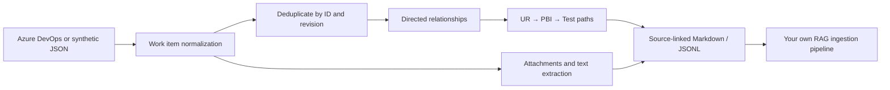

# ADOTraceFoundry

**From Azure DevOps traceability to source-linked, AI-ready engineering knowledge.**

[](https://github.com/RakeshSw/ado-trace-foundry/actions/workflows/ci.yml)

ADOTraceFoundry is a standalone **read-only** Python CLI for extracting Azure DevOps work items, preserving revisions and relationships, inspecting attachments, and building source-linked Markdown/JSONL knowledge documents. It is independent of Microsoft Foundry and is **not affiliated with Microsoft**. It does not create a vector index, make LLM calls, or upload work items to any AI provider.

## See the flow



## Quick start (GitHub Codespaces — no local installation)

Create a Codespace from this repository. In the terminal:

```bash
python -m pip install -e .
python -m adotracefoundry demo --input samples/workitems.json --attachments-dir samples/attachments --output output/demo
python -m unittest discover -s tests -v
cat output/demo/manifest.json
```

See `output/demo/knowledge/101.md`, `output/demo/traceability.json` and `output/demo/knowledge.jsonl`.

## Synthetic demo

The sample contains one requirement, two PBIs, two tests, a duplicate old revision and a text attachment. All data is fabricated.

```text
Requirement 101 ── PBI 201 ── Test 301
                └─ PBI 202 ── Test 302
```

Outputs include `workitems.jsonl`, `relationships.json`, `traceability.json`, `unresolved-links.json`, `attachment-manifest.json`, `knowledge.jsonl`, per-item Markdown and `manifest.json`. Records retain original IDs, revision numbers and custom fields. The knowledge output is intentionally **un-chunked** in v0.1; downstream RAG pipelines can apply their own chunk policy.

## Connect to an authorized Azure DevOps project

Requires a **read-only PAT** with the minimum work item permissions required for your use case. Never commit tokens or live exports. The tool only performs WIQL and GET calls; its WIQL request uses POST as required by the read-only Azure DevOps query API.

```bash
export ADO_PAT='YOUR_READ_ONLY_PAT'  # use an approved secret manager in practice
adotracefoundry sync --org YOUR_ORG --project YOUR_PROJECT --wiql-file samples/sample.wiql --max-items 100 --output output/live
```

Attachments are not downloaded by default. To download authorized attachments, add `--download-attachments`. Limits: up to 100 attachments per run, up to 15 MB each; requests reject external hostnames and redirects (some ADO attachment delivery configurations may therefore require an explicitly approved downloader). Use a test organization first. Work-item selection uses a capped WIQL list and does not automatically crawl every linked target.

## Document extraction

Text/Markdown/CSV/JSON works without optional dependencies. To enable PDF, DOCX, XLSX and PPTX text extraction:

```bash
pip install -e '.[documents]'
```

Image OCR is optional and requires `pip install -e '.[ocr]'` **and the Tesseract executable**. It is used only for raster image attachments when `--ocr` is set. **Scanned PDF OCR and embedded-image interpretation are not implemented** in v0.1; they are flagged for a later stage rather than silently claimed as complete.

## Security and limitations

- **Public-safe demo:** All sample content is synthetic; no organization-specific URLs, data, credentials or company code is bundled.
- **No mutation:** No ADO update, deletion, attachment upload or Search indexing endpoints are called.
- **No implicit AI upload:** Outputs remain local unless you explicitly ingest them elsewhere.
- **Confidentiality:** Do not publish real ADO extracts or attachments. Set least-privilege permissions and respect organizational policies.
- **No complete incremental sync:** Revision values are preserved, but the incremental change feed/checkpoint mechanism is not implemented in v0.1.
- **Trace coverage:** Only work items included in the current input are available for paths. External link IDs are reported as unresolved.
- **Attachment formats:** Parser results are best-effort and untrusted data should be processed in a sandboxed environment.
- **No production claim:** Live ADO access and optional document parsers have not been validated against an actual ADO organization in this release.

## Roadmap

1. Read-only live WIQL verification in a disposable authorized test project.
2. Revision-aware checkpointing and relationship-change detection.
3. PDF rasterization plus OCR, embedded image detection, extracted text quality metadata.
4. Heading-aware token-bounded chunking, stable chunk IDs and provenance maps.
5. Configurable work-item types, multi-project mapping and graph visualizations.

MIT licensing should be considered only after applicable publication rights are confirmed. This starter package intentionally includes **no license grant**.
