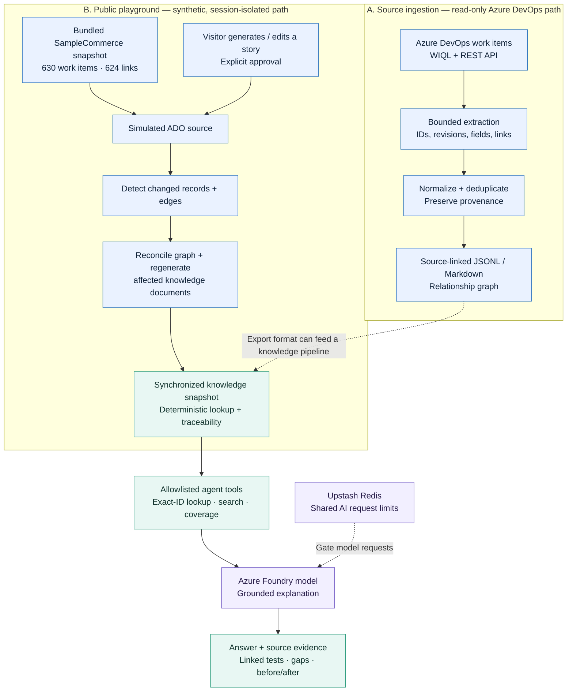
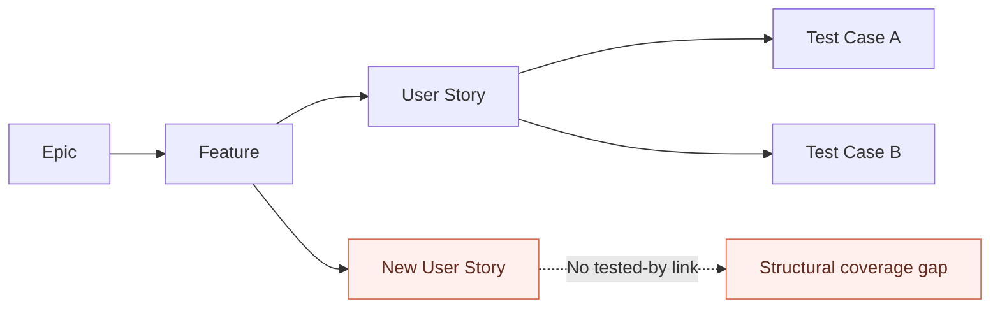

<div align="center">

# 🧠 ADOTraceFoundry

### From Azure DevOps work items to traceable, agent-ready engineering knowledge

**Extract. Connect. Synchronize. Ask with evidence.**

[](https://github.com/RakeshSw/ado-trace-foundry/actions/workflows/ci.yml)


### [🚀 Try the live playground](https://ado-trace-foundry-dntcsjawkcnpqcfximv8aw.streamlit.app/) · [💻 Explore the source](https://github.com/RakeshSw/ado-trace-foundry) · [🧪 Run the tests](#getting-started)

*A public, synthetic SampleCommerce demo. No Azure DevOps account is required to explore the playground.*

</div>

---

## The problem

Engineering knowledge is often scattered across **requirements, backlog items, test cases, revisions, relationships and attachments**. A plain-text search can find records without explaining how they connect, which tests actually link to a requirement, or whether an AI assistant is working with stale information.

**ADOTraceFoundry explores a more trustworthy pattern:** preserve work-item identity and traceability, assemble source-linked knowledge, and let a bounded AI agent explain evidence from a synchronized snapshot.

> **The key demonstration:** Create a synthetic requirement, ask about it *before* synchronization, refresh the knowledge snapshot, and ask the *same question* again. The difference is visible—and verifiable.

## See how it works



**Architecture boundary:** The Azure DevOps CLI is **read-only**. The hosted playground does **not** write to a real ADO project. Its incremental sync updates a **synthetic in-memory source**, its linked graph and its knowledge documents; it does **not** continuously poll Azure DevOps or rebuild a vector database.

## The 60-second experience

<table>
<tr><th>01 · Generate & save</th><th>02 · Ask before sync</th></tr>
<tr><td>Choose a Feature, generate an AI-assisted User Story, review and explicitly save it into the simulated source.</td><td>The new work item exists in the simulated source, <strong>not</strong> in synchronized knowledge. Exact-ID lookup reports that evidence is unavailable.</td></tr>
<tr><th>03 · Synchronize</th><th>04 · Ask after sync</th></tr>
<tr><td>Detect changed records, reconcile relationships, regenerate affected knowledge documents, and validate the new snapshot.</td><td>Ask the identical frozen question. The agent retrieves the new work item and explains its documented requirements and actual linked test cases.</td></tr>
</table>

### Before and after — evidence, not a scripted answer

| | 🔴 Before synchronization | 🟢 After synchronization |
|---|---|---|
| Synchronized records | **630** | **631** |
| Linked relationships | **624** | **625** (new parent-child link) |
| New work item, e.g. `WI-631` | Absent | Present |
| Requirement details | Cannot be verified | Retrieved from the synchronized record |
| Linked test cases | Unknown from old knowledge | Verified using actual `tested-by` relationships |
| AI calls in the comparison | **0** for the deterministic *before* check | **1** for the grounded *after* explanation |

*Illustrative example from the tested SampleCommerce workflow; counts vary as visitors change their session workspace. Linked test counts reflect structural relationships, not proof of complete functional coverage.*

**[▶ Experience it in the live app](https://ado-trace-foundry-dntcsjawkcnpqcfximv8aw.streamlit.app/)**

## Explore the capabilities

| Capability | What it does |
|---|---|
| **Read-only ADO ingestion** | WIQL-based work-item extraction through authorized Azure DevOps REST requests, with bounded retrieval and preserved source IDs/revisions. |
| **Work-item normalization** | Converts engineering records into structured JSONL and source-linked knowledge documents. |
| **Traceability graph** | Preserves hierarchy and `tested-by` links to reason about requirements and connected tests. |
| **Structural coverage intelligence** | Finds requirements without linked tests and identifies orphan test cases. |
| **Engineering Knowledge Agent** | Uses allowlisted, read-only tools for exact work-item lookup, deterministic lexical search, traceability, coverage, sync status and test-quality investigations. |
| **Grounded answers** | Retrieves evidence first, then uses Azure Foundry to explain it; exposes exact tool evidence in the UI. |
| **AI-assisted story design** | Generates a contextual story and editable demo question; saving requires explicit visitor approval. |
| **Incremental playground sync** | Processes changed in-memory records and affected relationships; reports before/after counts and regenerated documents. |
| **Functional coverage review** | Advisory assessment of documented criteria against available test-step evidence; distinct from structural link counts. |
| **Public-safe sandbox** | Packaged synthetic SampleCommerce data; per-session workspace; no real ADO modifications. |

### The traceability principle



A requirement can have a valid parent Feature and still have **zero linked test cases**. The agent reports that gap explicitly instead of treating tests elsewhere in the project as proof of coverage.

## Why the public demo does not write to Azure DevOps

The purpose of the public site is to demonstrate the **knowledge-synchronization workflow**, not to expose a shared ADO project to arbitrary edits.

Allowing anonymous visitors to create, change or delete real backlog items could introduce duplicates, invalid relationships and conflicting test data. To protect data integrity, ADOTraceFoundry intentionally uses an **isolated synthetic source** for visitor-generated changes.

Visitors still exercise real application logic for **change detection, incremental graph reconciliation, affected-document regeneration, source-grounded retrieval and before/after comparison**. These are not prerecorded responses.

**What this is—and isn't:**

- ✅ A read-only Azure DevOps extraction toolkit and a working incremental **agent-ready knowledge** demonstration.
- ✅ Live AI explanations based on synchronized synthetic evidence, when the hosted AI service is enabled and within quota.
- ✅ A traceability-oriented foundation for downstream RAG ingestion.
- ❌ Not a real-time ADO event listener, persistent multi-user data platform or continuously updated vector index.
- ❌ Not a public ADO write-back tool. Changes exist in the visitor's Streamlit session and can reset on browser/session refresh.

## Try these questions

```text
Explain work item 3 and its linked test cases.
Which requirements have no linked tests?
Check test quality for work item 3.
What changed after my last synchronization?
For work item 631, what are its acceptance criteria and which tests verify them?
```

When `WI-631` does not yet exist in *synchronized* knowledge, the agent should report that absence rather than answer from unsynchronized source data. After an explicit sync, it can examine the new record. Specific IDs created during a session may differ.

## Getting started

### Option A — Visit the hosted playground

Open **[ADOTraceFoundry on Streamlit Community Cloud](https://ado-trace-foundry-dntcsjawkcnpqcfximv8aw.streamlit.app/)**. You can explore the bundled synthetic dataset without an ADO login. Live AI functions depend on server-side model availability and shared rate limits.

### Option B — Run locally or in GitHub Codespaces

```bash
# From a checkout of this repository
python -m pip install -r requirements.txt

# Bundled synthetic demo is loaded automatically
streamlit run playground.py
```

The UI defaults to `samples/playground-snapshot/`, containing **630 synthetic work items and 624 relationships**. No ADO credentials are needed to open the app or explore deterministic knowledge. AI requests require separately configured **server-side** Azure AI and Upstash Redis credentials; never put secrets in source control.

### Run the test suite

```bash
python -m unittest discover -s tests -v
```

CI runs tests on pushes and pull requests. **58 tests passed** during the November 2026 deployment-readiness check; the current CI badge indicates the repository's latest workflow status.

### Generate an offline sample export

```bash
python -m adotracefoundry demo \
  --input samples/workitems.json \
  --attachments-dir samples/attachments \
  --output output/demo

python tools/traceability_report.py \
  --input samples/playground-snapshot \
  --output output/traceability-demo
```

These commands use synthetic data only. Generated outputs are written outside the committed source tree.

### Optional: read an authorized ADO project

The CLI uses a **read-only workflow**: WIQL retrieval, work-item GETs, optional bounded attachment retrieval and local export. Use an approved, least-privilege PAT in your own environment.

```bash
# Set ADO_PAT securely in your shell or secrets manager first
python -m adotracefoundry sync \
  --org YOUR_ORG \
  --project YOUR_PROJECT \
  --wiql-file samples/sample.wiql \
  --max-items 100 \
  --output output/authorized-export
```

Do not publish private exports, attachments, PATs, internal URLs or proprietary test records.

## Technology and engineering decisions

| Layer | Implementation |
|---|---|
| Data extraction | Python · Azure DevOps REST API · WIQL |
| Knowledge format | JSONL · Markdown · work-item IDs/revisions |
| Relationships | Directed hierarchy and tested-by graph |
| Deterministic retrieval | Exact work-item lookup · lexical search · graph traversal |
| AI reasoning | Azure Foundry / Azure OpenAI Responses API |
| Agent boundary | Bounded allowlisted tools; explicit approval before writes to synthetic state |
| UI and hosting | Streamlit · Streamlit Community Cloud |
| Model protection | Upstash Redis atomic request limits; fail-closed on missing limiter |
| Test automation | Python `unittest` · GitHub Actions |

### Public AI usage limits

The deployed playground is configured for **20 model requests per visitor-session per UTC hour**, **200 model requests per UTC day globally**, and **2 concurrent model requests globally**. A standard agent question often consumes two model calls; a story generation or *after-sync* explanation typically consumes one. Limits are **model requests**, not counts of stories or button clicks. Session-generated visitor IDs can be reset by starting a new session, so the global counter is the stronger shared safeguard. These numbers reflect the intended deployment configuration and can be changed server-side.

## Screenshots and demo media

**Screenshots are being collected from the actual hosted app** so the README does not display fabricated UI. Suggested captures:

1. **Engineering Agent** — question, answer, tool executed and inspectable evidence.
2. **Story generation** — editable User Story and generated demo question.
3. **Before / After** — the same question, side-by-side evidence and refreshed record counts.
4. **Sync report** — measured changed-record and relationship counts.

For the strongest portfolio presentation, add actual captures under `docs/images/` and replace this section with GitHub-hosted image references. Capture only synthetic work items; hide browser profiles, account details, credentials and deployment settings.

## Current boundaries and future extensions

- The public workspace is **session-scoped**, not persisted across browser sessions.
- Incremental sync operates on the **synthetic in-memory** source; the CLI's live ADO read does not currently operate as a scheduled, revision-aware change feed.
- Knowledge refreshes deterministic source-linked documents and graph lookups; **no vector embeddings are regenerated**.
- Test links demonstrate **structural coverage**. AI test-quality assessments are advisory, not execution results or a substitute for validated tests.
- A possible future production integration would combine authorized ADO change detection, durable checkpoints, a production retrieval index, access controls and monitored refresh jobs.

## License and attribution

Distributed under the [MIT License](LICENSE). ADOTraceFoundry is an independent portfolio project and is **not affiliated with or endorsed by Microsoft**. Azure DevOps, Azure and Streamlit are trademarks of their respective owners.

---

<div align="center">

**Engineering data changes. Your agent's knowledge should change with it.**

[**🚀 Launch the live demo**](https://ado-trace-foundry-dntcsjawkcnpqcfximv8aw.streamlit.app/) · [**⬆ Back to top**](#-adotracefoundry)

</div>
